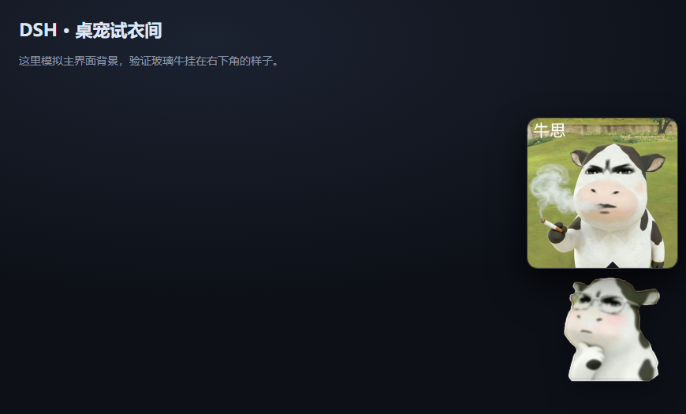
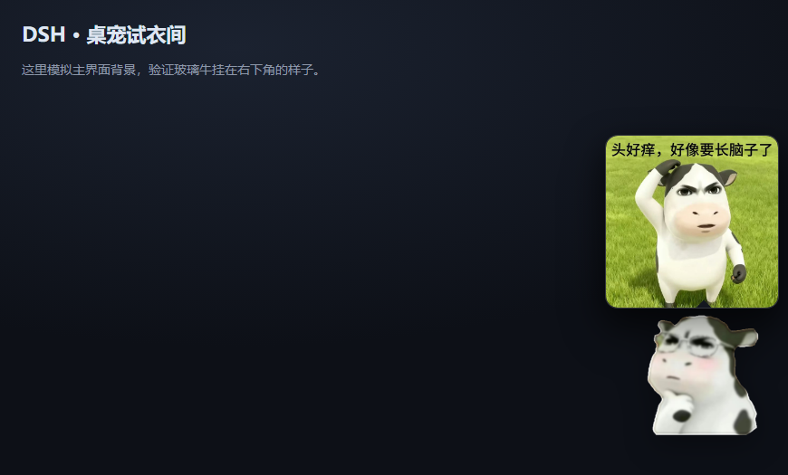
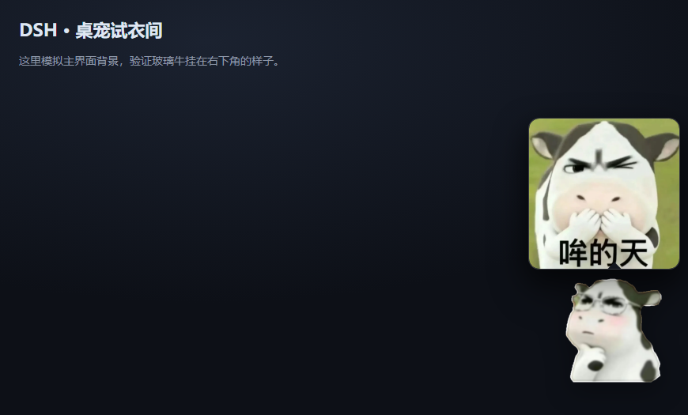
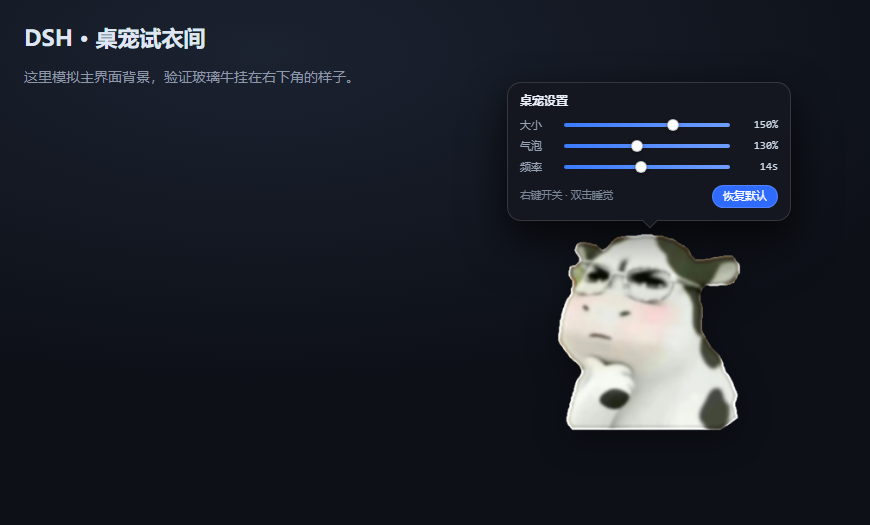
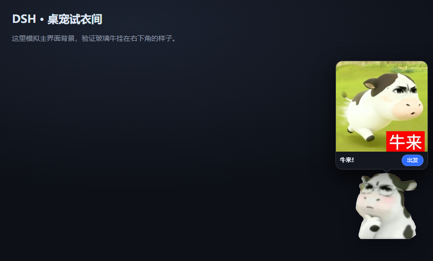

# dsh-cow-pet

挂在 [DeepSeek Harness](https://github.com/deepseek-ai) 窗口角落的一只玻璃牛：会呼吸、能拖走、戳一下会说话，
干活的时候在旁边递表情包。

不依赖任何框架，host 半页约 330 行、浏览器半页约 600 行，全部纯 ESM + 原生 DOM。



## 功能

- **悬浮桌宠**：右下角常驻，`pointer` 拖动，位置写回 `state.json`
- **点击互动**：戳一下蹦一下 + 冒气泡说句话
- **右键设置**：大小 / 气泡大小 / 思考气泡频率，滑块实时生效并落盘
- **三种时机的表情包气泡**：
  - 思考中 → 每 N 秒换一张（默认 7s）
  - 等权限 → 弹出来一直挂着，直到你处理完
  - 干完 → 冒一张庆祝图，4 秒后收
- **开机气泡**：每次启动在牛头顶弹一次「牛来！」，6 秒自动收
- **跟随干活状态**：装了 `dsh-balance-card` 时读 `/dsh-balance/turn.json`，开工收工各说一句

| 思考中 | 等权限 | 干完 |
| --- | --- | --- |
|  |  |  |

| 右键设置 | 开机气泡 |
| --- | --- |
|  |  |

## 安装

```bash
# 从 GitHub 装
dsh plugin --profile desktop add github:<your-name>/dsh-cow-pet

# 或者本地目录（开发时）
dsh plugin --profile desktop add "link:/abs/path/to/dsh-cow-pet"

# 卸载
dsh plugin --profile desktop remove dsh-cow-pet
```

装完**重启一次客户端**才出现（桌面端的 `<script>` 注入表是宿主启动时一次性收集的）。
之后改 `lib/pet.js` 只要 `Ctrl + R`，改 `lib/index.js` 才需要再重启。

## 右键设置

| 项 | 范围 | 说明 |
| --- | --- | --- |
| 大小 | 50%–200% | 100% = 132px |
| 气泡 | 60%–220% | 文字气泡、图片气泡、设置面板统一缩放 |
| 频率 | 8%–400% | 映射成秒（100% = 7s，范围 2–60s），只影响思考中换图 |

拖动即时生效，松手 420ms 后合并成一次 POST。变大时会自动把牛拉回视口内。
面板开着时不弹图片气泡；点别处 / Esc / 再右键一次收起；「恢复默认」一键回 100%。

## 它是怎么知道我在干嘛的

host 订阅 `session/event`，按事件名归类成三个阶段，前端每 1.5s 拉 `/dsh-cow-pet/phase.json`：

| 阶段 | 触发事件（实测） | 行为 |
| --- | --- | --- |
| `thinking` | `turn/start`、`step/start`、`assistant/message`、`tool/call` | 每 7s 换一张思考图 |
| `waiting` | `approval/asked`（配合 `approval/decided` 配对） | 弹图并一直挂着 |
| `done` | `turn/end` | 弹庆祝图 4.2s |

- 思考中 45 秒没有新事件自动回落，避免卡死时一直在抽烟
- `approval/asked` 与 `approval/decided` 是**一对**：只有「asked 比 decided 新」才算在等你
- 事件名是模式匹配猜的，宿主改名也不至于全废；`phase.json` 的 `events` 字段能看到最近 12 条真实类型名

## 路由

| 路径 | 说明 |
| --- | --- |
| `GET /dsh-cow-pet/pet.js` | 浏览器脚本 |
| `GET/POST /dsh-cow-pet/state.json` | 位置、大小、气泡比例、思考频率、睡觉状态 |
| `GET /dsh-cow-pet/phase.json` | 当前阶段 + 最近 12 条事件名 |
| `GET /dsh-cow-pet/asset/<name>.png` | 6 个表情 |
| `GET /dsh-cow-pet/mood/<file>` | 三种时机的表情包图 |
| `GET /dsh-cow-pet/startup.webp` | 开机那张原图 |
| `GET /dsh-cow-pet/poke?text=…` | 预留给别的插件调用 |

所有路由都只认回环 Host（`localhost` / `127.0.0.1` / `::1`），拒绝 `Sec-Fetch-Site: cross-site`，
Origin 必须同源；密钥类东西一概不碰。

状态落盘：`%USERPROFILE%\.dsh\dsh-cow-pet\state.json`（`DSH_HOME` 存在时用它）。

## 目录

```
lib/index.js      host 侧：路由、状态读写、事件订阅、脚本注入
lib/pet.js        浏览器侧：一只牛的全部行为
assets/cow/       6 张抠好的表情（426×460 PNG）
assets/mood/      三种时机的表情包（长边 640px）
assets/startup/   开机原图（6.webp）
tools/            离线抠图脚本（Pillow + numpy），只在生成素材时用
test/             自检脚本（见下）
docs/             截图
```

## 自检

```bash
node test/plugin-check.mjs    # 假 cordis root 跑 apply()：17 条路由、状态读写、夹取、安全栅栏
node test/visual-check.mjs    # 本地静态服务 + headless Edge：挂载/戳/拖/开机气泡/三阶段/右键设置
node test/align-check.mjs     # 只量几何：气泡是否在牛头顶居中、尾巴是否指着牛
```

`visual-check` 会真的起一个 headless Edge，通过 CDP 驱动鼠标事件并截图，断言的字段包括
`--size`、`--bubble-scale`、滑块文案、POST 载荷。

## 素材说明

表情包素材来自网络流传的奶牛表情图，这里只作为插件演示使用。
如果你的图被用在这里且不希望被使用，开个 issue，我会删掉。

抠图过程（含踩过的坑）记在 `README` 的历史里，脚本在 `tools/`：
背景是绿草地、牛的黑斑和草在 HSV 里容易混淆，最后用「用户手绘红线 → 径向采样 → 两套掩码取色」解决。

## License

MIT
